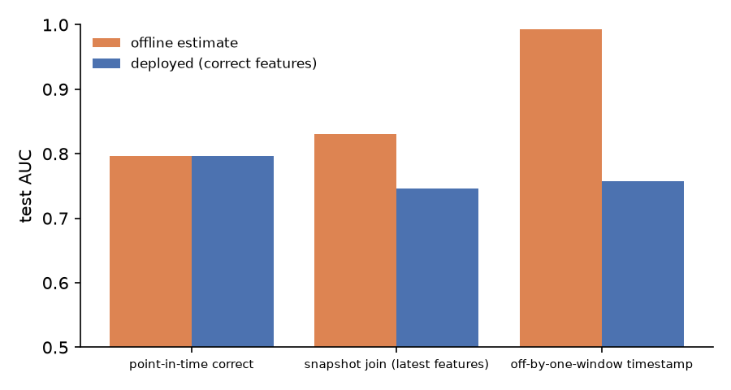
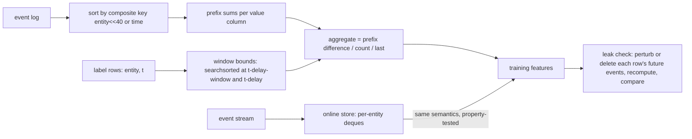

# pitstore

A point-in-time-correct feature store. It provides vectorised as-of window joins, an online store with a training/serving consistency guarantee, and a leakage test that fails when a pipeline uses future data. On a real retail dataset it measures what feature leakage does to evaluation: offline AUC rises from 0.797 to as high as 0.994, while the leaky model deployed with correctly computed features *drops* to 0.746–0.758.

[](https://github.com/eshaan2418/pitstore/actions/workflows/ci.yml)
[](LICENSE)


## Headline result

Task: will a customer buy again within 30 days? (UCI Online Retail II; 84,578 customer-month rows, temporal split, test period July to November 2011.) The same 10 feature definitions are computed three ways, and LightGBM is trained on each. Values are means over 3 seeds; brackets are customer-clustered bootstrap 95% CIs.

| feature pipeline | leak check | offline test AUC (what you report) | deployed AUC (what you get) | gap |
|---|---|---|---|---|
| **point-in-time correct** | **pass** (0/200) | 0.797 [0.788, 0.804] | **0.797** [0.788, 0.804] | 0.000 |
| snapshot join (latest feature table) | fail (108/200) | 0.830 [0.823, 0.837] | 0.746 [0.735, 0.755] | +0.085 |
| off-by-one-window timestamp | fail (108/200) | 0.994 [0.992, 0.995] | 0.758 [0.747, 0.765] | +0.235 |

"Deployed" evaluates each model on the features a production system can actually compute at prediction time, which are the point-in-time ones. Both leaky pipelines look better offline and are worse in production than the correct model, by 0.04–0.05 AUC. The leak check flags them, and the 92 unflagged sampled rows are customers with no future events to leak.



## Demo

```
$ pitstore demo
event table: 36,975 purchases, built in 2 ms
  point-in-time (as of query time)       PASS
  snapshot join (as of dataset end)      FAIL (60/100 queries saw future data)
  off-by-one-window (+30 days)           FAIL (60/100 queries saw future data)
```

## Why this exists

Training data for event-driven models (churn, fraud, recommendations) is built by joining labels to features computed from logs. Getting the timestamp of that join wrong is the most common way offline metrics lie. A "latest features" table joined to historical labels, or a window that includes the label period, makes a model look excellent in evaluation and then disappoint in production. Feature stores exist to prevent this, but the guarantee is rarely *tested*. pitstore makes the semantics explicit, tests that offline and online computation agree, and provides a check that fails on any pipeline (pitstore's or not) that reads the future.

## Highlights

- **Vectorised as-of joins.** A single int64 composite key `(entity, time)`, two `searchsorted` calls per window, and prefix sums. 1M queries over 1M events take 0.12 s, 19× faster than the equivalent pandas `merge_asof` pipeline, with identical results.
- **Online store with a consistency property test.** Replaying random event streams, the online value served just before each event equals the offline as-of value (Hypothesis).
- **Future-perturbation leakage check** for any feature pipeline. It recomputes under two counterfactual futures (randomised, deleted). It is sound, and a test confirms it flags *exactly* the queries whose answer depends on leaked events.
- **Explicit ingestion delay** (`delay`), so training features never use events the serving system would not yet have received.
- **A measured, real-data demonstration** of how leakage inflates offline metrics and lowers deployed ones.

## Quick start

```bash
git clone https://github.com/eshaan2418/pitstore && cd pitstore
make setup        # uv venv; numpy core, pandas/lightgbm for the experiment
make test         # brute-force, online/offline consistency, leakage-check tests
make data         # Online Retail II from UCI (checksum-verified)
make demo         # leakage check on three pipelines
make eval bench plots
```

```python
from pitstore.store import EventTable, Feature, check_point_in_time
DAY = 86_400
events = EventTable(customer_ids, unix_seconds, {"revenue": revenue})
feats = [Feature("revenue_90d", "sum", "revenue", window=90 * DAY, delay=DAY),
         Feature("days_since_last", "time_since_last", delay=DAY)]
X = events.historical_features(feats, label_customers, label_times)   # as-of join
assert check_point_in_time(events, feats, label_customers, label_times) == []
```

## Method



A feature for query `(entity, t)` aggregates events with `t − delay − window ≤ e < t − delay`. See [docs/DESIGN.md](docs/DESIGN.md).

## Results

Hardware: Apple M5, macOS 27.0.1. Software: Python 3.12.14, NumPy 2.5.4, pandas 3.1.0, LightGBM 4.7. Raw results: `eval/results/leakage.json`, `eval/results/bench_asof.json`. Tables are generated by `scripts/make_tables.py` into [eval/results/tables.md](eval/results/tables.md).

### Leakage experiment details

- Features (all with a 1-day ingestion delay): purchases in 30/90/365 days, revenue in 30/90/365 days, mean basket value over 365 days, invoice lines over 90 days, days since the last purchase, and returns over 365 days.
- Split: train on reference months up to 2011-04 (48,279 rows), early-stop on 2011-05/06 (9,759), test on 2011-07 to 2011-11 (26,540). Positive rate 21.5%.
- LightGBM: lr 0.05, 31 leaves, min 50 rows per leaf, 0.8 bagging and feature fraction, early stopping after 50 rounds. Seeds 0/1/2 (seed-to-seed spread ±0.001–0.003 AUC).
- A random (not temporal) 80/20 split on the snapshot features gives AUC 0.823. That is another commonly reported but optimistic number, though less inflated than the window bug.

### As-of join speed (synthetic: sum over a 1-hour window with a 60 s delay; results checked equal)

| events | queries | pitstore build s | pitstore query s | pandas merge_asof s | Python loop s |
|---|---|---|---|---|---|
| 10,000 | 10,000 | 0.002 | 0.0004 | 0.010 | 0.045 |
| 100,000 | 100,000 | 0.022 | 0.006 | 0.083 | - |
| 1,000,000 | 1,000,000 | 0.306 | 0.117 | 2.279 | - |
| 10,000,000 | 1,000,000 | 11.8 | 0.285 | 23.1 | - |

The build (one sort of the event log) is a one-off cost that is reused across feature definitions and query batches. Build plus query beats pandas at every size: 1.9× at 10M events and 5.4× at 1M. Other jobs were running on the machine, so absolute times are approximate.

Compute used: under 10 minutes in total.

## Error analysis

- **What the snapshot model learns.** Its top feature by split gain is `n_purchases_365d` (64% of gain, against 23% in the correct model), followed by `days_since_last` (16%). As of the dataset end, both count or reflect purchases made *after* the reference month, including the purchases the label is about. In production those features can only describe the past, so the model over-trusts a signal that is weaker at serving time.
- **The window leak is near-perfect offline (0.994).** `days_since_last` computed at `r + 30d` is at most 30 days exactly when the customer bought inside the label window, so it is nearly a copy of the label. It takes 77% of the model's gain, with `n_purchases_30d` second (15%). Any feature-importance plot from this model would be badly misleading.
- **Leak-check recall.** The first version of the check only moved future events to just after the cutoff. It missed snapshot leaks whose windows (90 days before the dataset end) never saw the moved events: 49/100 flagged against 60/100 for the deletion-augmented check. Of 100 sampled customers, 60 have purchases after the cutoff, so 60 is the maximum any check can flag.

## Design decisions and trade-offs

- **Prefix sums, not window re-scans.** O(1) per (query, feature) after the sort. The cost is that only decomposable aggregates (count, sum, mean) plus "last" are supported. Distinct counts and percentiles need different structures and are not implemented.
- **The online store recomputes on read** from a deque instead of maintaining running aggregates. This is simple, obviously equivalent to the offline semantics, and fast enough for per-entity histories of moderate size. A production version would maintain incremental aggregates with expiry.
- **The leakage check is a test, not a type system.** It cannot prove a pipeline correct, but it accepts arbitrary code and catches the two most common real-world bugs.

## Limitations, risks and ethical considerations

- One dataset and one task. The *size* of the leakage gap depends on how predictive the leaked information is. The direction (offline up, deployed down) is the general pattern.
- In-memory, single-process, and no persistence layer. This is a library for correct feature computation, not a deployed service.
- Customer behaviour data: the dataset is pseudonymous, and the repurchase model is used only to measure evaluation error. See [MODEL_CARD.md](MODEL_CARD.md) and [DATA_CARD.md](DATA_CARD.md).

## Project structure

```
src/pitstore/store.py     EventTable (offline as-of), OnlineStore, check_point_in_time
src/pitstore/cli.py       `pitstore demo`
scripts/prepare_data.py   Online Retail II -> invoice events
scripts/leakage_experiment.py   three pipelines x 3 seeds, offline vs deployed AUC
scripts/bench_asof.py     pitstore vs pandas merge_asof vs Python loop
tests/test_store.py       brute force, online/offline consistency, exact leak detection
```

## Citations

- Chen, D. *Online Retail II.* UCI Machine Learning Repository, 2019. CC BY 4.0.
- Kaufman, S., Rosset, S., Perlich, C. and Stitelman, O. *Leakage in Data Mining: Formulation, Detection, and Avoidance.* ACM TKDD 6(4), 2012.
- Sculley, D. et al. *Hidden Technical Debt in Machine Learning Systems.* NeurIPS 2015.
- Ke, G. et al. *LightGBM: A Highly Efficient Gradient Boosting Decision Tree.* NeurIPS 2017.

## License

MIT. See [LICENSE](LICENSE).
